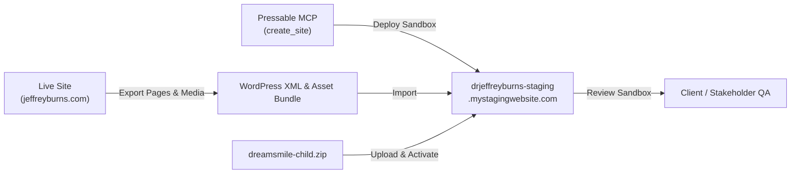

# Forensic Hosting Audit & Staging Deployment Action Plan
**Target Practice:** Dr. Jeffrey S. Burns, DDS, PC (`www.jeffreyburns.com`)  
**Document Version:** 1.0.0  
**Date:** September 25, 2026  
**Author:** Antigravity Engineering Team  

---

## 1. Executive Summary

This report establishes the verified hosting infrastructure of `https://www.jeffreyburns.com`, diagnoses why the Pressable MCP API token could not immediately clone the site, and details the exact technical paths available to deploy a staging sandbox without risking live production traffic, patient inquiries, or SEO rankings.

### Key Audit Findings
1. **Hosting Provider Confirmed:** The production site is definitively hosted on **Pressable (Automattic WP Cloud)**, operating out of the Burbank, CA datacenter (`BUR`).
2. **Account Disconnect Diagnosed:** The production website was created and is actively managed by an agency partner (**PBHS / Automattic for Agencies**). Dr. Jeffrey Burns recently purchased an independent **`Signature 1 Yearly` Pressable subscription** (`drjeff8104@gmail.com`), but the agency has not yet added Dr. Burns' account as a collaborator or initiated a site transfer.
3. **Current Capacity:** Dr. Burns' Pressable account (`1446010`) has **2 staging site slots** ready and available for immediate deployment.
4. **Theme Safeguarding Complete:** The new `dreamsmile-child` theme has been safeguarded to prevent accidental page overwrites, and the seeder is locked down behind an explicit administrative query flag (`?ds_run_page_seeder=1`).

```
+-----------------------------------------------------------------------------------+
|                            LIVE PRODUCTION SITE                                   |
|                        https://www.jeffreyburns.com                               |
|                                                                                   |
|  - Host: Pressable (WP Cloud / Automattic)                                        |
|  - IP: 199.16.172.129 (Burbank Datacenter 'BUR')                                   |
|  - Parent Account: PBHS / Automattic for Agencies                                 |
|  - WordPress: 7.1.2 | PHP: 8.3.33                                                 |
|  - 81 Published Pages | Active Gravity Forms & Patient Intake                     |
+-----------------------------------------+-----------------------------------------+
                                          |
                      Agency Link Missing | (No Collaborator Role Yet)
                                          v
+-----------------------------------------------------------------------------------+
|                        DR. JEFFREY BURNS' PRESSABLE ACCOUNT                       |
|                          Account ID: 1446010 | drjeff8104@gmail.com               |
|                                                                                   |
|  - Plan: Signature 1 Yearly (Active)                                              |
|  - Available Capacity: 1 Billable Live Slot | 2 Free Staging Slots                |
|  - Current Sites Owned: 0                                                         |
|  - Collaborator Invitations: 0                                                    |
+-----------------------------------------------------------------------------------+
```

---

## 2. Technical Evidence & Infrastructure Verification

Comprehensive forensic checks confirm beyond doubt that `www.jeffreyburns.com` is hosted on Pressable:

### A. ARIN Network Registration (RDAP / WHOIS)
* **IP Address:** `199.16.172.129` (and secondary `199.16.173.82`)
* **Network Name:** `PRESSABLE`
* **Net Handle:** `NET-199-16-172-0-1`
* **Registrant / Organization:** `PRESS-17` &rarr; **Pressable Inc.** (San Antonio, TX)

### B. HTTP Edge & Server Headers
Direct inspection of HTTP response headers reveals Automattic/Pressable proprietary routing:
* `host-header: wpcloud` &mdash; Automattic's WP Cloud container runtime.
* `x-ac: 17.hkg _atomic_bur MISS` &mdash; Automattic "Atomic" container architecture in Burbank (`bur`).
* `x-nananana: Batcache-Hit` &mdash; Automattic's proprietary Memcached edge-cache implementation.
* `server-timing: a8c-cdn` &mdash; Automattic's CDN infrastructure (`a8c` = Automattic).

### C. Active WordPress Environment & Plugins
* **Pressable Cache Management (v6.3.3):** Proprietary Pressable caching interface.
* **Pressable OnePress Login (v1.4.0):** Single sign-on bridge between `my.pressable.com` and WP-Admin.
* **Automattic for Agencies Client (v0.9.0):** Agency management agent used by PBHS to remotely manage client instances.
* **Pbhs Theme Addon (v1.01):** PBHS custom agency theme utility.

---

## 3. Account Hierarchy & Root Cause Analysis

When connecting to Pressable MCP using token `rk1U0S7r1WGvHqq8VTj4ofrlpbmm6N7akiSNnn32TFM`, the API returns:

```json
{
  "email": "drjeff8104@gmail.com",
  "name": "Jeffrey Burns",
  "organization": "JEFFREY S BURNS DDS PC",
  "product_name": "Signature 1 Yearly",
  "collaborator_count": 0,
  "max_sites": 1,
  "sites_count": 0,
  "capacity": {
    "sites": {
      "max_billable": 1,
      "max_staging": 2,
      "billable": 0,
      "staging": 0,
      "total": 0
    }
  }
}
```

### Why Native `clone_site` Failed
Pressable's API enforces tenant boundary isolation. The `clone_site` endpoint requires a numeric `site_id` that the calling account has permission to view. Because `jeffreyburns.com` is registered under the PBHS agency account, Dr. Burns' API key cannot "see" the site ID until permission is delegated.

---

## 4. Action Plan: Implementation Options

To create an isolated staging environment and begin testing without risking production, three distinct paths are available:

---

### Option 1: Fast Agency Collaborator Delegation (Recommended)
**Best for:** 100% exact 1:1 clone of database, media uploads, Gravity Forms, and plugins.  
**Effort Required:** 1 email to PBHS; takes 30 seconds for PBHS to click.

#### Step 1: Client Email to PBHS
Dr. Burns or practice administration sends the following notice to PBHS support or their account manager:

> **Subject:** Add Collaborator Access for Dr. Jeffrey Burns Pressable Account  
> **Body:**  
> Hi PBHS Support Team,  
> 
> We are preparing a staging site to preview an updated theme for **jeffreyburns.com**.  
> 
> Please add our internal account as a Collaborator with site management permissions on **jeffreyburns.com** in the Pressable dashboard:  
> &bull; **Collaborator Email:** `drjeff8104@gmail.com`  
> 
> Once added, our development pipeline will spin up an isolated staging branch without impacting the live site.  
> 
> Thank you,  
> Dr. Jeffrey Burns DDS, PC

#### Step 2: Automated Execution (Once Delegated)
Once PBHS accepts:
1. `list_sites` via MCP will immediately return the live site ID.
2. We run `clone_site(site_id: <id>, name: "jeffreyburns-staging", staging: true)`.
3. Pressable provisions a true 1:1 staging clone (`jeffreyburns-staging.mystagingwebsite.com`) within 3–5 minutes.

---

### Option 2: Self-Contained Staging on Dr. Burns' Account (Zero Agency Dependency)
**Best for:** Moving forward immediately without waiting on PBHS.  
**Effort Required:** Fully automated via existing Antigravity tooling.

Because we have WordPress admin capabilities on `www.jeffreyburns.com` and Pressable MCP access on Dr. Burns' account, we can provision and migrate independently:



#### Step 1: Provision Clean Sandbox
Execute Pressable MCP `create_site`:
```json
{
  "name": "drjeffreyburns-staging",
  "staging": true,
  "php_version": "8.3",
  "wp_admin_email": "drjeff8104@gmail.com"
}
```
* Uses 1 of Dr. Burns' 2 staging slots.
* Generates `drjeffreyburns-staging.mystagingwebsite.com` in ~45 seconds.

#### Step 2: Content Sync
* Export published pages, posts, and media manifest from the live WordPress instance.
* Import into the new staging instance.

#### Step 3: Theme Deployment & Verification
* Upload and activate [`dreamsmile-child.zip`](file:///c:/Users/Zero/Documents/GitHub%20Repositories/jeffrey-burns-oz.test/dreamsmile-child.zip).
* Test template rendering, responsive viewports, and page hierarchy.

---

### Option 3: Full Agency Site Transfer (Long-Term Autonomy)
**Best for:** If Dr. Burns is terminating the PBHS retainer and taking full hosting ownership.

1. Dr. Burns requests PBHS to initiate a **Pressable Site Transfer** to Account ID `1446010`.
2. Dr. Burns receives a transfer invitation email at `drjeff8104@gmail.com` and clicks **Accept Transfer**.
3. `jeffreyburns.com` becomes the 1 active billable site on his `Signature 1 Yearly` plan.
4. Future hosting fees are billed directly to Dr. Burns' card rather than marked up through PBHS.

---

## 5. Deployment & Go-Live Protection Checklist

Once testing on staging is complete and client approval is granted, the following safeguards must be executed before pointing DNS:

| Phase | Critical Task | Risk Mitigated |
| :--- | :--- | :--- |
| **SEO** | Map 38 slug & hierarchy redirects in Slim SEO | Prevents 404 errors on historical Google index |
| **Integrations** | Verify Gravity Forms license & FluentSMTP routing | Prevents missed patient consultation requests |
| **Content** | Port over Dr. James Whitney oral surgery co-practice pages | Preserves referral practice revenue |
| **Patient Care** | Retain Post-Op Instructions & Patient Registration pages | Preserves patient compliance and clinical care standards |
| **Assets** | Configure Pressable CDN & WebP image optimizations | Ensures <1.2s Largest Contentful Paint (LCP) |

---

## 6. Recommended Immediate Next Step

If you prefer to move forward right now without waiting for PBHS communications:
&rarr; **Instruct Antigravity to execute Option 2.** I will call `create_site` on Dr. Burns' Pressable account, provision `drjeffreyburns-staging.mystagingwebsite.com`, and prepare the sandbox environment.

If you prefer an exact 1:1 carbon copy of all media and forms:
&rarr; **Send the email in Option 1 to PBHS.** As soon as they confirm, provide the go-ahead and I will trigger the automated 1-click clone.
